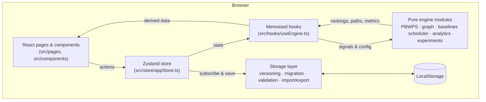
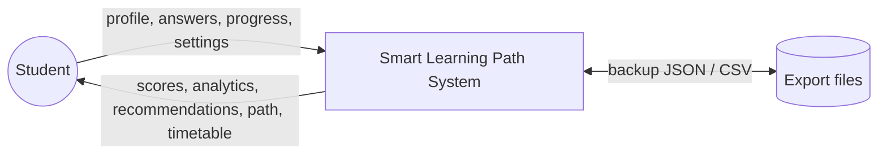
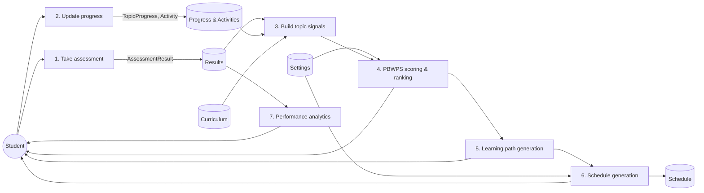
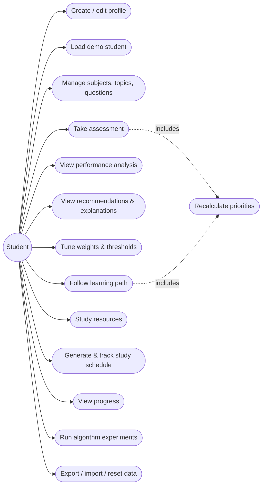
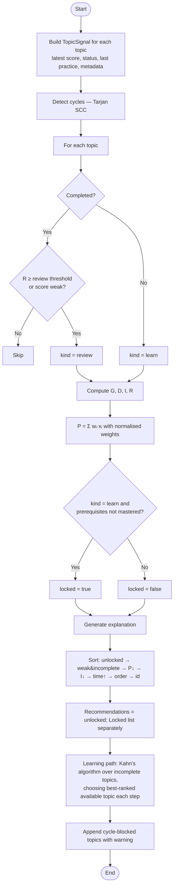

# Smart Learning Path Recommendation System — Project Report

**Proposed research title:** *An Adaptive Learning Path Recommendation Framework Using Performance-Based Weighted Priority Scheduling*
**Project type:** Academic software mini project / IEEE-oriented research prototype
**Architecture:** Frontend-only single-page application (React, TypeScript, Vite)

---

## 1. Project Abstract

Students who prepare for examinations on their own often cannot tell which topics most deserve their limited study time. Fixed syllabus order ignores individual weaknesses. Purely score-driven advice ignores the order in which knowledge must be built. This project presents the *Smart Learning Path Recommendation System*, a browser-based application that turns topic-level assessment results into a prioritised, prerequisite-aware learning path and study timetable. Its core is **Performance-Based Weighted Priority Scheduling (PBWPS)**. PBWPS combines four normalised factors into a single priority, P = 0.40G + 0.25D + 0.20I + 0.15R, with configurable weights: knowledge gap (G), topic difficulty (D), curriculum importance (I) and a forgetting-curve revision requirement (R). It validates prerequisites, so topics whose foundations are not mastered are never recommended first. It then orders all remaining work with a priority-driven topological sort. Every recommendation comes with an explanation.

The system is evaluated against an equal-priority baseline and a gap-only baseline on 120 reproducible simulated student profiles. On this synthetic data, PBWPS achieved the highest recommendation relevance (nDCG@5 = 73.2% vs 62.2% and 52.6%) and full prerequisite compliance (100% vs 51.5% for the gap-only method). It identified fewer weak topics in its top five than the gap-only method (31.0% vs 42.6%), because many weak topics were locked behind unmastered prerequisites. All results are simulated. Effects on real student learning still require empirical validation.

## 2. Introduction

Personalised learning tries to adapt what a learner studies, and when, to their current knowledge. Intelligent tutoring systems and adaptive hypermedia have explored this for decades [1], [2]. Many solutions, however, depend on server infrastructure, large data sets or machine-learning models that are hard to inspect. For an individual student, a useful recommender needs to be:

- **evidence-based**, driven by the student's own assessment results;
- **structurally sound**, never asking the learner to study material before its prerequisites;
- **transparent**, explaining each recommendation in plain language;
- **lightweight and private**, running without accounts or servers.

This project builds such a system as a static web application and develops PBWPS, a deterministic, explainable scheduling algorithm, as its research contribution.

## 3. Problem Statement

Given a curriculum of subjects and topics, each with difficulty, importance, estimated study time and prerequisite relations, and given a student's assessment history and progress, determine:

1. a **priority** for every topic that still needs learning or revision;
2. a **ranked list** of topics the student can start *now*;
3. a **complete learning sequence** that never violates prerequisite constraints;
4. a **study timetable** that fits the student's availability and exam deadline.

The solution must update instantly when new evidence arrives, explain its decisions, and run entirely in a web browser.

## 4. Existing System

Students commonly plan their study in one of these ways:

- **Syllabus order.** Following the textbook or course outline sequentially.
- **Self-assessment.** Choosing topics by feeling or recent difficulty.
- **Generic learning platforms.** Course websites with fixed module order and progress bars.
- **Score-based revision lists.** Revisiting topics with the lowest test scores.
- **Server-based adaptive platforms.** Commercial or institutional systems that personalise content using back-end analytics.

## 5. Existing System Limitations

| Approach | Limitation |
| --- | --- |
| Syllabus order | Ignores individual strengths and weaknesses; time is spent on already-mastered topics. |
| Self-assessment | Subjective; students often misjudge their own knowledge. |
| Fixed-order platforms | Personalisation is limited to progress tracking. |
| Lowest-score-first | Ignores prerequisites, so students may be sent to advanced topics they cannot yet understand. Also ignores importance and forgetting. |
| Server-based adaptive systems | Need accounts, connectivity and infrastructure; their models are often opaque; student data leaves the device. |

## 6. Proposed System

The proposed system is a single-page web application with these characteristics:

- A **topic assessment engine** measures knowledge per topic (5+ multiple-choice questions each).
- **PBWPS** converts measurements into priorities using four normalised factors and configurable weights.
- **Prerequisite validation** locks topics until each prerequisite is completed or scored at or above a mastery threshold (default 60%).
- **Learning path generation** with a priority-driven topological sort (Kahn's algorithm) produces an order that never violates prerequisites.
- **Explanations** state the measured gap, the main contributing factor, prerequisite status and the number of topics each topic unlocks.
- A **deterministic scheduler** packs the path into a timetable that respects daily hours, study days and the exam date.
- An **experimental module** compares PBWPS with two baselines on reproducible simulated profiles.
- **Local-first storage** (versioned LocalStorage with migration, validation, JSON backup/restore and CSV export) keeps all data on the device.

## 7. Research Gap

1. Many learning-path recommenders rank by performance *or* by curriculum structure, but do not combine a weighted multi-factor priority with hard prerequisite constraints in one transparent procedure.
2. Revision needs (forgetting over time) are rarely integrated into the same priority score as new-learning needs.
3. Explainability is often an afterthought; few systems show the per-factor contribution to each recommendation.
4. Prototypes are seldom accompanied by a reproducible, open evaluation harness that compares them with simple baselines on the same data.

PBWPS addresses these points with a weighted, explainable priority, prerequisite-constrained scheduling and a seeded evaluation framework. Whether these properties translate into better *learning outcomes* is an open question **[Requires real-student validation]**.

## 8. Objectives

1. Design and implement the PBWPS priority model with independently testable factor functions.
2. Implement prerequisite validation, cycle detection and prerequisite-safe learning path generation.
3. Provide human-readable explanations for every recommendation.
4. Build a complete frontend application covering assessments, analytics, learning paths, resources, scheduling and progress tracking.
5. Persist all data locally with versioning, validation, migration and import/export.
6. Evaluate PBWPS against two baselines with reproducible simulated data and clearly defined metrics.
7. Verify correctness with automated unit and integration tests.

## 9. Scope

**In scope:** individual student use; a single local profile per browser; a multiple-choice assessment engine; the PBWPS engine and baselines; a scheduling engine; analytics; local persistence; a simulated evaluation; static hosting.

**Out of scope:** multi-user accounts, teacher dashboards, server synchronisation, adaptive question selection (item response theory), machine-learning models, and live studies with students (left as future work).

## 10. Software Requirements Specification

### 10.1 Hardware and software

| Item | Requirement |
| --- | --- |
| Client | Any modern browser (Chrome, Edge, Firefox, Safari — current versions) with JavaScript and LocalStorage enabled |
| Development | Node.js 18+ (tested with 24), npm, Visual Studio Code, Git |
| Hosting | Any static file host (Netlify, Vercel, GitHub Pages) |

### 10.2 Technology stack

React 18, TypeScript 5 (strict), Vite 5, Tailwind CSS 3, Lucide React icons, Recharts, React Router 6, Zustand 5, Vitest 2 and React Testing Library.

### 10.3 Users

A single student user. A "demo student" mode loads a pre-populated profile for demonstrations.

## 11. Functional Requirements

| ID | Requirement |
| --- | --- |
| FR-1 | The user can create, view and edit a local student profile (name, email, interests, education level, daily study time, goals). |
| FR-2 | The user can load a demo student or start a new empty history. |
| FR-3 | The user can add, edit and delete subjects, topics and questions; prerequisites that would create a cycle are prevented in the editor. |
| FR-4 | The user can take a topic assessment; incomplete submissions are rejected; the score, an answer review and explanations are shown. |
| FR-5 | Each submission updates the performance analytics, knowledge gaps, priorities, recommendations, learning path and dashboard. |
| FR-6 | The system classifies performance into four bands with configurable thresholds. |
| FR-7 | The system calculates PBWPS priorities, ranks topics, validates prerequisites, separates locked topics and explains each recommendation. |
| FR-8 | Recommendation weights and engine parameters are configurable, and changes re-rank immediately. |
| FR-9 | The system generates a prerequisite-safe learning path; the user can start, complete and review topics. |
| FR-10 | Each topic has resources of five types; the user can mark them complete and add or delete custom resources. |
| FR-11 | The system generates a study timetable from daily hours, study days and exam date, detects conflicts, marks missed sessions, reschedules them and tracks completed sessions. |
| FR-12 | The system tracks completed topics, assessments, learning hours, daily and weekly activity, streaks and topic improvement. |
| FR-13 | The user can run the A/B/C experiment on ≥100 seeded simulated profiles and export the results. |
| FR-14 | The user can export data as JSON and CSV, restore a JSON backup after validation, reset to demo data and delete all data after confirmation. |

## 12. Non-Functional Requirements

| ID | Category | Requirement |
| --- | --- | --- |
| NFR-1 | Privacy | No data leaves the browser; there are no network calls for core functionality. |
| NFR-2 | Performance | A ranking and path for 50 topics is computed in under 5 ms on a typical laptop (measured: ≈0.6 ms per profile). |
| NFR-3 | Reliability | Data survives page refreshes; corrupted or newer-version storage is detected and reported rather than crashing the app. |
| NFR-4 | Maintainability | Algorithms are pure functions independent of React; TypeScript strict mode; modular folders. |
| NFR-5 | Usability | Responsive layout (mobile, tablet, desktop), accessible labels, keyboard-dismissable dialogs, visible focus rings. |
| NFR-6 | Reproducibility | Experiments and demo data are deterministic for a given seed and date. |
| NFR-7 | Portability | Deployable as static files to any host. |

## 13. System Architecture



**Layering.**
1. *Presentation*: pages and reusable UI components.
2. *State*: one Zustand store holds all persisted data and the actions that mutate it.
3. *Derivation*: hooks convert state into algorithm inputs (`TopicSignal`) and memoise results.
4. *Domain*: pure TypeScript algorithms with no React or browser dependencies.
5. *Persistence*: versioned serialisation to LocalStorage.

## 14. Data Flow Diagram

**Level 0 (context)**



**Level 1**



## 15. Use Case Diagram



## 16. Activity Diagram — taking an assessment

```mermaid
flowchart TD
  A([Start]) --> B[Open topic assessment]
  B --> C{Topic has questions?}
  C -- No --> C1[Show "add questions" prompt] --> Z([End])
  C -- Yes --> D[Answer questions / navigate]
  D --> E{All questions answered?}
  E -- No --> D
  E -- Yes --> F[Submit]
  F --> G[Calculate score, store result, log activity]
  G --> H[Recompute signals → PBWPS ranking → learning path]
  H --> I[Show score, band, priority before/after, answer review]
  I --> J{Retake?}
  J -- Yes --> D
  J -- No --> Z
```

## 17. Algorithm Flowchart — PBWPS



## 18. Algorithm Mathematical Explanation

Let *T* be the set of topics. For topic *t*:

- *s(t)* ∈ [0, 100] ∪ {⊥} is the latest assessment score (⊥ = never assessed);
- *ℓ(t)* ∈ {1,…,5} is the difficulty level;
- *imp(t)* ∈ [0, 100] is the importance;
- *Δt(t)* ≥ 0 is the number of days since the latest assessment, review or completion;
- *pre(t)* ⊆ *T* is the set of prerequisites.

**Knowledge gap**
G(t) = 100 − s(t) when s(t) ≠ ⊥; otherwise G(t) = G₀ (configurable assumed gap, default 60).

**Normalised difficulty**
D(t) = (ℓ(t) − 1) / (5 − 1) × 100, giving 0, 25, 50, 75 and 100.

**Importance**
I(t) = clamp(imp(t), 0, 100).

**Revision requirement** (exponential forgetting curve, after Ebbinghaus [3])
R(t) = 100 · (1 − exp(−Δt(t) / S(t))), with stability S(t) = S₀ · (0.5 + s(t)/100). Here S₀ is a configurable base stability (default 14 days). A topic never practised has R = 0, because its need is already captured by G. Higher mastery decays more slowly: a perfect score lasts three times as long as a zero score.

**Weight normalisation**
Given raw weights w = (w_G, w_D, w_I, w_R) with wᵢ ≥ 0, let ŵᵢ = wᵢ / Σⱼ wⱼ. If all weights are zero, ŵᵢ = 0.25.

**Priority**
P(t) = ŵ_G·G + ŵ_D·D + ŵ_I·I + ŵ_R·R ∈ [0, 100]. The default is ŵ = (0.40, 0.25, 0.20, 0.15).

**Priority levels**
Critical: P ≥ 80. High: 60 ≤ P < 80. Medium: 40 ≤ P < 60. Low: P < 40.

**Mastery and prerequisite validation**
A topic *u* is mastered when status(u) = completed or s(u) ≥ θ (default θ = 60). Topic *t* is *eligible* when every u ∈ pre(t) that exists is mastered. References to deleted topics are ignored.

**Candidate set**
C = {t : status(t) ≠ completed} ∪ {t : status(t) = completed ∧ (R(t) ≥ ρ ∨ s(t) < τ_dev)}. Here ρ is the review threshold (default 60) and τ_dev is the Developing threshold (default 40).

**Ranking order** (lexicographic key, ascending)
key(t) = (locked(t), ¬(weak(t) ∧ learn(t)), −P(t), −I(t), time(t), order(t), id(t)), where weak(t) ⇔ s(t) ≠ ⊥ ∧ s(t) < τ_dev. This order is total and deterministic, so equal priorities are resolved reproducibly.

**Learning path**
Build the graph over incomplete topics, with an edge u → t for each u ∈ pre(t) that is not yet mastered. Kahn's algorithm [4] repeatedly removes, from the set of nodes with in-degree zero, the node with the smallest key. This produces a topological order π in which every prerequisite precedes its dependants, while preferring high-priority work whenever the constraints allow. Nodes on a cycle are found with Tarjan's SCC algorithm [5]. They never reach in-degree zero, so they are appended and flagged.

**Complexity**
For n topics and m prerequisite edges, factor computation is O(n), cycle detection O(n + m), ranking O(n log n), and path generation O(n² log n) in the simple array-based implementation (O((n + m) log n) with a binary heap). With n = 50, generation took ≈0.6 ms per profile in our measurements.

## 19. Database-Free Storage Architecture

- **Single key.** All data is serialised to one LocalStorage key, `smart-learning-path:data`, as a versioned `AppData` JSON document (about 250 KB of JSON with the demo data).
- **Versioning and migration.** `version` is checked on load. Migration functions keyed by source version upgrade old documents step by step (for example, v1 → v2 adds `completedResourceIds` and `schedule`). Data from a *newer* version is rejected with a clear message.
- **Validation.** `validateAppData` checks the structure, types and ranges of every subject, topic, question (exactly four options, correct index 0–3), result (score 0–100) and activity. Missing settings are filled from defaults, and results pointing to deleted topics are dropped.
- **Persistence loop.** The Zustand store is the single source of truth. A store subscription saves only when a persisted field changes. Quota and availability errors appear as a dismissible banner.
- **Import/export.** JSON backups are wrapped in an envelope `{format, exportedAt, data}` and pass through migration and validation before the user confirms a restore. CSV exports (topic progress, assessment history) use RFC 4180-style quoting.
- **Why not IndexedDB?** The data is small, well under LocalStorage limits, and LocalStorage's synchronous API keeps the persistence layer simple. The storage module is isolated, so switching to IndexedDB later would affect only `src/lib/storage`.

## 20. Module Descriptions

| # | Module | Main files | Description |
| --- | --- | --- | --- |
| 1 | Introduction | `pages/LandingPage.tsx` | Purpose, features, how the algorithm works, benefits, "Get started" and demo access. |
| 2 | Student profile | `components/domain/ProfileForm.tsx`, `pages/SettingsPage.tsx` | Validated profile form used for onboarding and editing. |
| 3 | Dashboard | `pages/DashboardPage.tsx` | KPIs, next recommendation, weekly activity, subject progress, recent assessments. |
| 4 | Subject management | `pages/SubjectsPage.tsx`, `pages/SubjectDetailPage.tsx`, `*FormModal.tsx` | CRUD for subjects, topics and questions; cascade deletes; cycle-safe prerequisite picker. |
| 5 | Assessment | `pages/AssessmentOverviewPage.tsx`, `pages/TakeAssessmentPage.tsx`, `lib/engine/assessment.ts` | Question navigation, enforced completeness, scoring, review, history. |
| 6 | Performance analysis | `pages/PerformancePage.tsx`, `lib/engine/performance.ts` | Bands, subject/topic scores, trends, improvement. |
| 7 | Recommendation engine | `lib/engine/pbwps.ts`, `lib/engine/graph.ts`, `pages/RecommendationsPage.tsx` | PBWPS scoring, ranking, locking, explanations, weight tuning, per-student method comparison. |
| 8 | Learning path | `pages/LearningPathPage.tsx` | Roadmap with start/complete/review actions. |
| 9 | Resources | `pages/ResourcesPage.tsx`, `data/seed.ts` | Five resource types per topic, completion tracking, custom resources. |
| 10 | Schedule | `lib/engine/scheduler.ts`, `pages/SchedulePage.tsx` | Deterministic packing, deadline handling, conflicts, missed-session rescheduling. |
| 11 | Progress | `lib/engine/progress.ts`, `pages/ProgressPage.tsx` | Streaks, daily/weekly activity, improvements, activity log. |
| 12 | Settings & data | `pages/SettingsPage.tsx`, `lib/storage/*` | Preferences, weights, thresholds, export/import/reset. |
| — | Experiments | `lib/engine/experiments.ts`, `lib/engine/baselines.ts`, `pages/ExperimentsPage.tsx` | Simulation, three methods, five metrics. |

## 21. Implementation Details

- **Strict typing.** All domain entities are defined in `src/types/index.ts`. Algorithms consume a narrow `TopicSignal` view built by `buildTopicSignals`, so the engine is decoupled from storage shape.
- **Single source of truth.** Every mutation is a named store action (for example `submitAssessment`, `completeTopic`, `setSessionStatus`), and each action logs a `LearningActivity` where relevant. Derived data such as rankings, paths and analytics is never stored. It is recomputed through memoised hooks, which keeps every view consistent after any change.
- **Determinism.** Seeded PRNG (mulberry32) and Box–Muller sampling [6] generate both the demo history and the simulated profiles. All sorts have total orderings.
- **Cascade integrity.** Deleting a subject or topic removes its questions, resources, results, progress and schedule sessions, and strips its id from other topics' prerequisites.
- **UI.** Tailwind design tokens (indigo/navy primary, violet accent, light-grey surface). A responsive sidebar becomes a drawer on mobile. Pages are code-split with `React.lazy`. An error boundary prevents a blank screen.
- **Routing.** React Router with a profile guard. All application routes redirect to the landing page when no profile exists.
- **Static hosting.** `public/_redirects` (Netlify), `vercel.json` (Vercel), and a `404.html` copy (GitHub Pages) make deep links work.

## 22. Testing Report

**Tooling:** Vitest 2 with jsdom, React Testing Library and user-event. Command: `npm run test`.

| Suite | Tests | Coverage of requirements |
| --- | --- | --- |
| `lib/engine/pbwps.test.ts` | 35 | Knowledge gap (zero, perfect, unassessed, clamping); difficulty normalisation; revision curve; weight normalisation; priority formula; level boundaries; prerequisite validation (missing, deleted); cycle detection incl. self-loops; cycle prediction; ranking with no history; locked topics; weak-first; equal-priority tie-breaks; weight changes; explanations; empty curriculum; path ordering; cycle-blocked paths |
| `lib/engine/assessment.test.ts` | 11 | Score calculation (0%, 100%, rounding, empty); incomplete-submission prevention; invalid indexes; performance bands; threshold validation; improvement |
| `lib/engine/scheduler.test.ts` | 12 | Capacity and study-day constraints; in-day path order; determinism; weekend skipping; exam deadline conflicts; no study days; past exam; regeneration on availability change; completed-session preservation and missed rescheduling; priority merge; streaks; weekly grouping |
| `lib/storage/storage.test.ts` | 12 | JSON round-trip; raw vs envelope import; invalid JSON; foreign file; invalid structures; out-of-range scores; default settings; CSV escaping; LocalStorage save/load; corrupted storage; v1 → v2 migration; newer-version rejection |
| `lib/engine/experiments.test.ts` | 7 | ≥100 reproducible profiles; seed sensitivity; simulation consistency; method eligibility; nDCG; bounded metrics; compliance invariants |
| `data/seed.test.ts` | 6 | ≥5 subjects × ≥10 topics; ≥5 well-formed questions per topic; valid acyclic prerequisites; all resource types; reproducible valid demo data |
| `test/app.test.tsx` | 5 | Route protection; demo access updates dashboard; onboarding validation; assessment cannot be submitted incomplete and is recorded when complete; 404 route |
| **Total** | **88** | **All passing** (last run: 7 files, 88 tests, 0 failures) |

The TypeScript compiler (`tsc --noEmit`, strict mode) reports 0 errors, and the production build (`npm run build`) succeeds. The only console output during tests is a Recharts warning that charts have zero size. This happens because jsdom performs no layout; it does not occur in real browsers.

## 23. Experimental Evaluation

> **All results in this section are SIMULATED.** They come from synthetic student profiles produced by a seeded generator and measure algorithm behaviour, not learning outcomes. **[Requires real-student validation]**

**Dataset.** 120 simulated profiles (seed 20251101) over the built-in curriculum of 50 topics. Each profile has a latent ability A ~ N(60, 16²), clamped to [15, 95]. True mastery is m(t) = clamp(0.7·(A − 7(ℓ − 3) + ε) + 0.3·mean(m(pre(t)))), with ε ~ N(0, 14²). Each profile assesses 30–80% of its topics, with observed score = round((m + N(0, 9²)) / 20) × 20, as in a 5-question quiz. A topic is marked completed (with probability 0.6) only when its observed score is ≥ 60 and its prerequisites are completed. The reference date is fixed.

**Methods.**
- **A — Equal Priority.** Eligible incomplete topics in curriculum order.
- **B — Performance-Based.** Incomplete topics sorted by knowledge gap, ignoring prerequisites.
- **C — PBWPS.** The proposed method, with default weights.

**Metrics** (K = 5; "weak" means true mastery < 40):
- **Weak Topic Identification Rate (WTIR):** |topK ∩ weak| / min(K, |weak|).
- **Recommendation Relevance:** nDCG@K [7], with graded relevance equal to the true gap (100 − m)/100.
- **Prerequisite Compliance:** share of the top-K whose prerequisites are mastered.
- **Path Completion Rate:** a simulated learner follows the full sequence with a 600-minute budget; a step fails, costing 30 min, if its prerequisites are not yet mastered.
- **Generation Time:** mean wall-clock time per ranking plus sequence.

**Results** (`npm run experiments`, Node 24, Windows laptop; mean ± SD over profiles):

| Method | WTIR | nDCG@5 | Prerequisite compliance | Path completion | Time (ms) |
| --- | --- | --- | --- | --- | --- |
| A Equal Priority | 16.7% ± 28.9 | 52.6% ± 17.0 | 100.0% ± 0.0 | 100.0% ± 0.0 | 0.171 |
| B Performance-Based | **42.6%** ± 40.8 | 62.2% ± 22.8 | 51.5% ± 25.8 | 88.8% ± 21.1 | **0.038** |
| C PBWPS | 31.0% ± 34.6 | **73.2%** ± 11.3 | **100.0%** ± 0.0 | **100.0%** ± 0.0 | 0.648 |

Robustness check with a second seed (777): A 13.7 / 52.0 / 100 / 100; B 43.3 / 63.9 / 56.3 / 90.1; C 28.1 / 75.2 / 100 / 100 (WTIR / nDCG / compliance / completion, %). The ordering of the methods was the same.

Timing values depend on the device and vary between runs. The quality metrics are exactly reproducible for a given seed and settings.

## 24. Results and Discussion

- **Relevance.** On simulated data, PBWPS produced the most relevant top-5 lists (nDCG +11.0 points over B and +20.6 over A), with the lowest variance. Combining gap with importance, difficulty and revision need, while restricting to eligible topics, gives lists that track the hidden true need more closely.
- **Feasibility.** PBWPS and A never recommended a topic whose prerequisites were unmastered. B did so for about half of its recommendations (compliance 51.5%). As a result, its simulated learner wasted time on blocked steps (path completion 88.8%).
- **Trade-off in weak-topic identification.** B surfaced more truly weak topics (42.6% vs 31.0%) because it is free to recommend weak topics that are still locked. PBWPS deliberately postpones these until their foundations are mastered. Whether this postponement helps or hinders real learners is an empirical question **[Requires real-student validation]**. Researchers who want B's behaviour can raise the gap weight or lower the prerequisite mastery score in Settings and re-run the experiment.
- **Cost.** PBWPS is slower than the baselines because it also builds explanations and a topological path, but at under 1 ms it is negligible for interactive use.
- **Threats to validity.** The simulator encodes our own assumptions about how mastery relates to difficulty and prerequisites. The relevance metric uses true gap only, and both A and C are evaluated on compliance, which they enforce by construction. Results may differ on other curricula or simulators.

## 25. Limitations

1. The evaluation is simulation-only; no study with real students has been conducted.
2. Assessments are short (≈5 items), so the measured gap is coarse (20-point steps).
3. The weights are set by expert judgement and are not learned from data.
4. The forgetting-curve parameters are generic and not personalised.
5. Data is local to one browser; there is no synchronisation across devices.
6. The curriculum content is sample material written for demonstration, not a validated syllabus.
7. The scheduler is greedy. It does not optimise across topics (for example, interleaving) and does not account for fatigue.

## 26. Future Enhancements

- A controlled study with real students comparing learning gains and engagement across methods A, B and C.
- Weight learning from outcome data, for example by regression on later score gains.
- Bayesian knowledge tracing [8] or item response theory for finer-grained mastery estimates.
- Adaptive question selection and larger, calibrated question banks.
- Optional encrypted cloud sync and teacher dashboards.
- Interleaved and spaced scheduling informed by distributed-practice research [9], [10].
- Offline-installable PWA and IndexedDB for very large curricula.

## 27. Conclusion

This project delivers a complete, frontend-only adaptive learning application and a transparent recommendation algorithm, PBWPS. PBWPS combines a weighted multi-factor priority with hard prerequisite constraints and explains every decision. The application works end to end: assessments update analytics, recommendations, the learning path and the study schedule instantly, and all data persists locally with validation and backup support. In a reproducible simulated evaluation, PBWPS achieved the highest recommendation relevance and full prerequisite compliance, at the cost of identifying fewer locked weak topics than a gap-only approach. The software is ready for static deployment. The research claims about effects on learning remain to be validated with real students.

## 28. References

> The references below are well-established works cited for background. Please verify bibliographic details against the original sources before formal submission.

[1] P. Brusilovsky, "Adaptive hypermedia," *User Modeling and User-Adapted Interaction*, vol. 11, no. 1–2, pp. 87–110, 2001.
[2] N. Manouselis, H. Drachsler, R. Vuorikari, H. Hummel, and R. Koper, "Recommender systems in technology enhanced learning," in *Recommender Systems Handbook*, F. Ricci, L. Rokach, B. Shapira, and P. B. Kantor, Eds. Boston, MA, USA: Springer, 2011, pp. 387–415.
[3] H. Ebbinghaus, *Memory: A Contribution to Experimental Psychology*, H. A. Ruger and C. E. Bussenius, Trans. New York, NY, USA: Teachers College, Columbia University, 1913 (original work published 1885).
[4] A. B. Kahn, "Topological sorting of large networks," *Communications of the ACM*, vol. 5, no. 11, pp. 558–562, 1962.
[5] R. Tarjan, "Depth-first search and linear graph algorithms," *SIAM Journal on Computing*, vol. 1, no. 2, pp. 146–160, 1972.
[6] G. E. P. Box and M. E. Muller, "A note on the generation of random normal deviates," *The Annals of Mathematical Statistics*, vol. 29, no. 2, pp. 610–611, 1958.
[7] K. Järvelin and J. Kekäläinen, "Cumulated gain-based evaluation of IR techniques," *ACM Transactions on Information Systems*, vol. 20, no. 4, pp. 422–446, 2002.
[8] A. T. Corbett and J. R. Anderson, "Knowledge tracing: Modeling the acquisition of procedural knowledge," *User Modeling and User-Adapted Interaction*, vol. 4, no. 4, pp. 253–278, 1994.
[9] N. J. Cepeda, H. Pashler, E. Vul, J. T. Wixted, and D. Rohrer, "Distributed practice in verbal recall tasks: A review and quantitative synthesis," *Psychological Bulletin*, vol. 132, no. 3, pp. 354–380, 2006.
[10] J. Dunlosky, K. A. Rawson, E. J. Marsh, M. J. Nathan, and D. T. Willingham, "Improving students' learning with effective learning techniques," *Psychological Science in the Public Interest*, vol. 14, no. 1, pp. 4–58, 2013.
[11] B. S. Bloom, "The 2 sigma problem: The search for methods of group instruction as effective as one-to-one tutoring," *Educational Researcher*, vol. 13, no. 6, pp. 4–16, 1984.
